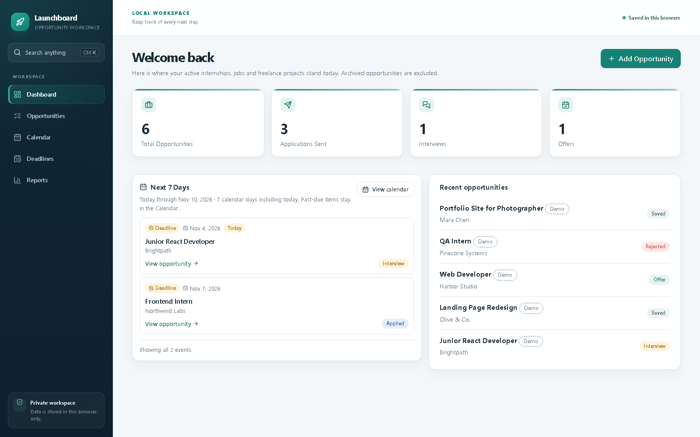
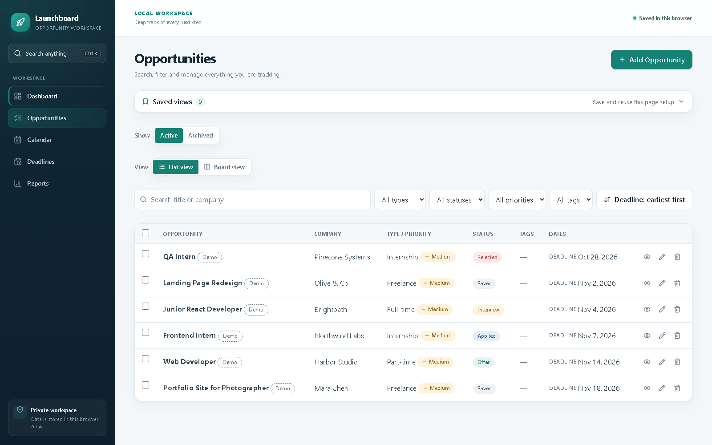
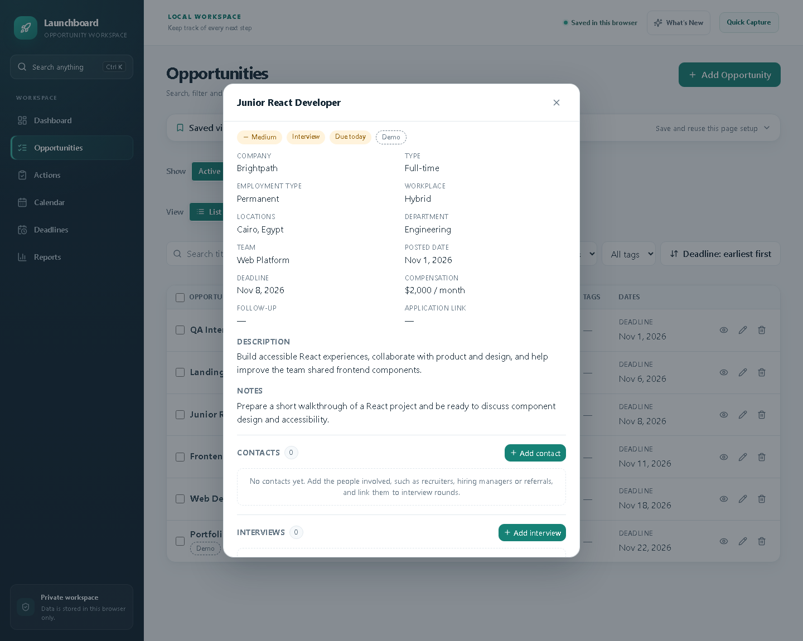
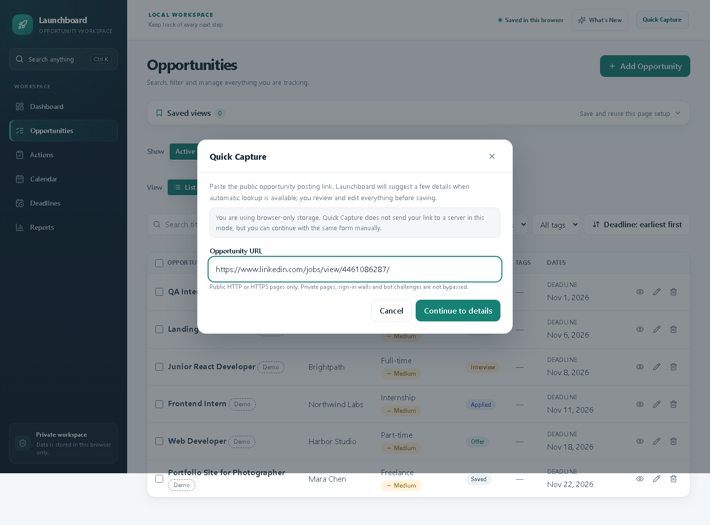

# Launchboard

**A personal workspace for tracking opportunities.** Collect internships, jobs, and freelance projects you discover on external platforms, then organize every application and follow-up in one place.

[**Open Launchboard (production)**](https://launchboard-drab.vercel.app/)

## Preview

<p align="center">
  
  <br><em>Dashboard — a quick view of the active pipeline and the next seven days.</em>
</p>

<p align="center">
  
  <br><em>Opportunities — search, filter and manage the application pipeline.</em>
</p>

<p align="center">
  
  <br><em>Opportunity details — structured job information, description and notes.</em>
</p>

<p align="center">
  
  <br><em>Quick Capture — review supported public job-page suggestions or continue manually; LinkedIn links stay manual.</em>
</p>

> Launchboard is an opportunity tracker, not a freelancing marketplace. It helps you manage opportunities you find elsewhere; it does not publish jobs or connect clients with freelancers.

## What you can do

- **See the big picture:** a dashboard with active opportunity summaries, upcoming activity, and recent records.
- **Manage opportunities:** create, edit, search, filter, sort, and switch between list and board views.
- **Keep applications organized:** track status, priority (including Contract opportunities), deadlines, follow-up dates, compensation, tags, and notes.
- **Manage the full workspace:** attach interviews, contacts, application materials, and activity history to each opportunity.
- **Capture faster:** use Quick Capture to review suggested details from supported public employer/ATS pages, inspect field evidence, and continue manually when a page is unsupported. LinkedIn links stay manual.
- **Plan your next actions:** manage opportunity-linked tasks in the Action Center with priorities, optional due dates, completion, and clear overdue/upcoming groups.
- **Stay on top of work:** see overdue and due-today tasks on the Dashboard and dated open tasks in Calendar, without mixing them with deadlines or interviews.
- **Review progress:** view reports and export your records.
- **Find anything quickly:** use global search with `Ctrl + K` (or `Cmd + K` on macOS).
- **Work safely with your data:** archive and restore records, use bulk actions with Undo, import CSV files, and create or restore full JSON backups.
- **Choose where data lives:** use the browser-only local workspace or opt into the authenticated API workspace.
- **Manage your account:** in signed-in mode, update your display name, change your password, or delete your account with password and confirmation safeguards.
- **Recognise account emails:** verification, password-reset and password-change messages use consistent Launchboard-branded HTML and plain-text layouts.

## Screens and workflows

| Area | Purpose |
| --- | --- |
| Dashboard | Active pipeline overview, next-seven-days summary, and recent opportunities |
| Opportunities | List/board views, filters, saved views, archive/restore, bulk actions, and Undo |
| Action Center | Opportunity-linked tasks grouped by due date and completion state |
| Calendar | Deadlines, follow-ups, interviews, and a distinct filter for dated open tasks |
| Deadlines | Focused view of upcoming and overdue deadlines |
| Reports | Pipeline metrics, CSV export, and CSV/JSON import |
| Account Settings | Signed-in profile display name, password change, and account deletion controls |

Each opportunity can contain its own interview rounds, contacts, materials, and activity history. The Calendar is derived from these records; it is not a separate calendar store.

## Tech stack

**Frontend:** React 18, TypeScript, Vite, Tailwind CSS v4, and Lucide React.

**Backend:** Node.js, Express 5, TypeScript, Zod, and mysql2.

**Shared domain:** a small TypeScript workspace package containing shared types, controlled values, validation rules, date helpers, limits, and backup normalization.

**Authentication and security:** Argon2id password hashing, database-backed HttpOnly sessions, CSRF protection, exact-origin checks, rate limits, email verification, password recovery, and protected account self-service controls. Account emails include responsive branded HTML and plain-text versions.

**Database:** MySQL-compatible storage. Local development supports MariaDB/MySQL; the hosted application uses TiDB Cloud Serverless.

## Data modes

Launchboard has two intentionally separate persistence modes:

### Local workspace (default)

The default app stores opportunity data in this browser's `localStorage`. It does not require an account or a running backend, and data is not automatically shared between browsers or devices.

Export a JSON backup regularly. JSON is the full-fidelity backup format and preserves archived records, nested workspace data, and opportunity-linked tasks.

### Authenticated API workspace (opt-in)

Set `VITE_DATA_MODE=api` when building or starting the frontend to use the Express API. This mode requires a configured backend, database, authentication settings, and email delivery settings. User data is scoped to the authenticated account and stored by the server.

Signed-in users can open Account Settings to manage an optional display name, change their password, and permanently delete their account after password and confirmation checks. Sign-in email changes are not available. Browser-only local mode remains independent and does not require an account.

The modes do not synchronize automatically. Moving local records to an account is an explicit migration with a preview and a backup safeguard; it does not delete the browser's local data.

### CSV and JSON are different

- **CSV** is for tabular transfer. It includes the supported opportunity columns and activity data, but does not preserve archive state, interviews, contacts, or materials.
- **JSON** is the full Launchboard backup/restore format. Use JSON when you need to preserve the complete workspace.

## Try the built-in demo

A fresh browser-only local workspace automatically starts with six synthetic opportunities. They are marked **Demo** so they are easy to distinguish from records you add yourself. Existing browser data is not replaced by the sample set.

To explore the sample workflow, start the frontend locally and open it in a fresh browser profile or private window:

1. Open the Dashboard to review the opportunity totals and upcoming deadlines.
2. Go to **Opportunities** and open **Junior React Developer** at **Brightpath**.
3. Add a contact, then create an interview round and link it to that contact.
4. Add application-material metadata for a resume and record an update in the activity timeline.
5. Explore Calendar, Deadlines and Reports to see the same opportunities from different views.

The screenshots above use a fresh, isolated browser profile and synthetic demo records. They do not contain or expose any data from the hosted authenticated workspace.

## Getting started

### Requirements

- Node.js **20.12 or newer** (Node.js 24.x is used for the hosted runtime).
- npm.
- A MySQL/MariaDB-compatible database only when you intend to run API mode.

### Install and run the frontend

```bash
npm ci
npm run dev
```

Open the local URL printed by Vite (usually `http://localhost:5173`). The default local workspace works without database configuration.

### Run the API locally

In a second terminal:

```bash
npm run dev:server
```

The API listens on `http://127.0.0.1:3000` by default. The Vite development server proxies same-origin `/api` requests to it.

For database-backed development:

1. Copy `server/.env.example` to `server/.env`.
2. Create a dedicated `launchboard` database and separate runtime and migration accounts.
3. Fill in the local database, authentication, and email settings in the ignored `server/.env` file.
4. Apply migrations deliberately with `npm run db:migrate`.
5. Verify the schema and runtime grants with `npm run db:verify-live`.

The migration runner only targets a database named `launchboard`. It does not create databases automatically and must never be pointed at another project database. See [Server setup](server/README.md) before provisioning a database.

To run the frontend in API mode during local development, set the Vite variable before starting it:

**PowerShell**
```powershell
$env:VITE_DATA_MODE = "api"
npm run dev
```

**bash / zsh**
```bash
VITE_DATA_MODE=api npm run dev
```

## Useful commands

| Command | Description |
| --- | --- |
| `npm run dev` | Start the Vite frontend |
| `npm run dev:server` | Start the Express API in watch mode |
| `npm test` | Run frontend, shared-domain, and server tests |
| `npm run test:watch` | Run frontend/domain tests in watch mode |
| `npm run test:server` | Run server tests only |
| `npm run build` | Type-check and build the frontend |
| `npm run build:server` | Compile the backend |
| `npm run typecheck:server` | Type-check the backend |
| `npm run test:focus` | Run the Playwright dialog-focus checks |
| `npm run release:prepare` | Build, stage and checksum-verify the reusable Vercel prebuilt package without uploading it |
| `npm run release:production` | Upload the verified package and create one confirmed Production deployment; requires `VERCEL_TOKEN` |

The Playwright focus suite needs browser binaries installed once:

```bash
npx playwright install chromium firefox webkit
npm run test:focus
```

## Repository layout

```text
.
├── api/                  # Vercel catch-all API entry point
├── deployment/           # Release and prebuilt-deployment helper scripts
├── docs/                 # Architecture, API, auth, deployment, UI notes, and screenshots
│   └── screenshots/      # Genuine local-app captures used in this README
├── packages/
│   └── domain/           # Shared, environment-independent domain package
├── server/
│   ├── database/         # SQL bootstrap and versioned migrations
│   ├── scripts/          # Database and release smoke utilities
│   └── src/              # Express API, auth, repositories, and services
├── src/
│   ├── components/       # Shared React components
│   ├── data/             # Local and HTTP persistence adapters
│   ├── hooks/            # Application state and auth hooks
│   ├── pages/            # Dashboard, opportunities, calendar, deadlines, reports
│   └── utils/            # Domain-facing frontend utilities
└── README.md
```

## Documentation

- [Backend contract](docs/backend-contract.md) — data model, API shapes, ownership, transactions, and backup behavior.
- [Authentication design](docs/auth-design.md) — sessions, CSRF, verification, password recovery, and security decisions.
- [Deployment guide](docs/deployment-readiness.md) — Vercel, database configuration, and release checks.
- [UI redesign](docs/ui-redesign.md) — visual system, responsive behavior, and preserved workflows.
- [Server setup](server/README.md) — database accounts, migrations, environment variables, and backend operations.
- [Shared domain package](packages/domain/README.md) — shared types, rules, module boundaries, and build order.
- [v1.2.0 release notes](docs/v1.2-release-notes.md) — Action Center features and compatibility.
- [v1.3.0 release notes](docs/v1.3-release-notes.md) — Quick Capture, structured details and LinkedIn limitations.
- [v1.3.5 release notes](docs/v1.3.5-release-notes.md) — Account Settings, opportunity workflow improvements, branded account emails, migrations and verification evidence (release candidate; deployment status is tracked here).

## Deployment

The live demo is hosted on Vercel at [launchboard-drab.vercel.app](https://launchboard-drab.vercel.app) and uses TiDB Cloud Serverless for the authenticated workspace.

The root `vercel.json` routes `/api/*` requests, including nested authentication and capture endpoints, through the catch-all Vercel function. Other paths are rewritten to the SPA entry point. The separate `deployment/vercel.json` is used by the reusable prebuilt-upload workflow. Run `npm run release:prepare` for a local build/package/checksum preflight, or `npm run release:production` for the explicitly confirmed one-shot Production upload and read-only smoke checks. The latter requires `VERCEL_TOKEN`; it does not create a Preview, run migrations, send email, or perform account/record CRUD. Follow the exact-SHA Preview gate in the [deployment guide](docs/deployment-readiness.md) whenever a release requires Preview acceptance.

Production credentials are configured in the hosting environment. Never commit real `.env` files, SMTP app passwords, database passwords, CSRF secrets, or other credentials. The repository includes only `server/.env.example` as a safe template.

## Project scope and security notes

Launchboard is a personal learning and portfolio project. Its API includes account verification and recovery, ownership-scoped data access, version checks, and rate limiting, but the current rate-limit store is process-local. Review operational controls and use a shared rate-limit store before scaling to multiple application instances. Do not treat this project as a security-certified service or store highly sensitive information in it.

The local workspace remains the default and is suitable for trying the application without provisioning infrastructure. The authenticated workspace is an optional, separately configured mode.
